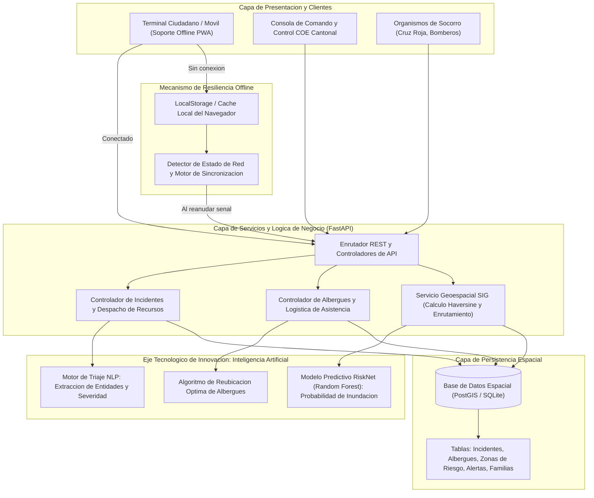

# Esmeraldas Resiliente

### "Programar hoy para proteger vidas mañana"

Plataforma integral de prevencion, monitoreo cartografico y gestion de emergencias ante los efectos del fenomeno El Nino en la ciudad y provincia de Esmeraldas, Ecuador.

Desarrollada para el concurso oficial **Hackathon UTLVTE 2026 (INNOVA-TI)** por la **Facultad de Ingenierias (FACI)** y la **Carrera de Tecnologias de la Informacion** de la Universidad Tecnica Luis Vargas Torres de Esmeraldas.

* **Equipo de Desarrollo:** OpenCode (Codigo Oficial de Acreditacion: UTLVTE-9216)
* **Nivel Academico:** 9no Ciclo Paralelo "A"
* **Eje Tematico Asignado:** Inteligencia Artificial & Machine Learning

---

## 1. Contexto y Justificacion del Proyecto

La provincia de Esmeraldas presenta condiciones geograficas, hidrologicas y topograficas que incrementan la vulnerabilidad de su poblacion ante eventos hidrometeorologicos extremos. Las precipitaciones asociadas al fenomeno El Nino provocan periodicamente el desbordamiento simultaneo de los rios Esmeraldas y Teaone, anegando sectores urbanos consolidados, interrumpiendo vias arteriales esenciales y aislando comunidades rurales.

Frente a este escenario, las instituciones de respuesta (COE Cantonal y Provincial, Cuerpo de Bomberos, Policia Nacional y Cruz Roja) enfrentan dificultades criticas:
1. Dispersion y demora en la recepcion de llamadas y mensajes de auxilio ciudadanos.
2. Perdida de conectividad movil en los sectores anegados, lo que impide el envio de reportes en tiempo real.
3. Ausencia de georreferenciacion precisa de los incidentes sobre capas cartograficas de riesgo.
4. Sobrecarga y saturacion no coordinada de albergues temporales.

**Esmeraldas Resiliente** responde a esta problematica articulando tecnologias de la informacion modernas: una arquitectura web resiliente con capacidad de funcionamiento sin conexion (Offline-First), servicios geoespaciales interactivos (SIG) y dos motores de Inteligencia Artificial orientados a la prediccion hidrologica y al triaje automatizado de mensajes de emergencia.

---

## 2. Arquitectura General del Sistema

El sistema implementa una arquitectura orientada a servicios (SOA) estructurada en cuatro capas desacopladas:



### Componentes de la Arquitectura
* **Frontend Web (Single Page Application):** Construido sobre estandares HTML5, CSS semantico (Tailwind CSS) y la biblioteca cartografica Leaflet.js 1.9. Disenado con una interfaz grafica tecnica, sobria y orientada a salas de crisis, empleando la libreria de iconografia Font Awesome 6.
* **Backend y API REST:** Desarrollado en Python 3.12 utilizando el framework de alto rendimiento FastAPI montado sobre el servidor ASGI Uvicorn. Integra validacion tipada de esquemas mediante Pydantic v2 y generacion automatica de documentacion OpenAPI / Swagger UI.
* **Capa de Inteligencia Artificial:** Modelos matematicos y algoritmos implementados con Scikit-Learn 1.9, NumPy y expresiones regulares para analisis semantico de texto.
* **Capa de Persistencia:** Esquema relacional estructurado con soporte de tipos geometricos espaciales (Point, Polygon) compatible con PostgreSQL 16 + PostGIS 3.4 y SQLite 3 para entornos de despliegue local.

---

## 3. Modulos Funcionales Implementados

### Modulo 1: Sistema de Informacion Geografica (SIG)
Visualizacion interactiva de la red territorial de Esmeraldas centrada en las coordenadas base `[-0.9682, -79.6517]`. Incluye:
* Poligonos de zonas de alta amenaza delimitados por analisis de cuenca:
  * 50 Casas y Ribera del Rio Teaone (Inundacion severa).
  * Isla Luis Vargas Torres (Inundacion fluvial y pleamar costera).
  * San Rafael y Propicia 1 al 4 (Saturacion de drenaje pluvial).
  * El Cabezon / Via E15 Esmeraldas - Atacames (Deslizamiento de ladera).
  * Sector Las Palmas y Malecon (Oleaje y drenaje).
  * Valle Rural Tabiazo - Carlos Concha (Desbordamiento de cuenca alta).
* Marcadores dinamicos de incidentes clasificados por colores segun su nivel de severidad.
* Ubicacion de albergues con semaforo de capacidad y estado de suministros.
* Trazado vectorial de rutas de evacuacion seguras con calculo de distancias.

### Modulo 2: Reporte Ciudadano con Capacidad Offline
Formulario optimizado para dispositivos moviles que permite el registro directo de eventos adversos:
* Captura automatica de coordenadas GPS del navegador o seleccion manual mediante clic sobre el mapa.
* Clasificacion del evento en 6 categorias operativas: Inundacion Urbana, Desbordamiento de Rio, Deslizamiento de Ladera, Personas Atrapadas, Via Interrumpida y Falta de Suministros.
* **Mecanismo de Resiliencia Offline:** En caso de perdida de conectividad celular o WiFi durante la lluvia, el reporte se almacena localmente en la memoria del navegador (`localStorage`). Al restablecerse la conexion a internet, un proceso en segundo plano detecta el evento de red y transmite los reportes acumulados sin intervencion manual ni duplicacion de registros.

### Modulo 3: Centro de Operaciones de Emergencia (COE)
Modulo de mando y control para autoridades y evaluadores de danos:
* Panel consolidado de metricas en tiempo real: total de incidentes activos, conteo de situaciones criticas, porcentaje global de ocupacion de albergues y numero de personas censadas.
* Bandeja de incidentes con priorizacion automatica segun el puntaje de urgencia asignado por la IA.
* Gestion del ciclo de vida del incidente: actualizacion de estados entre "Pendiente", "En Atencion" y "Atendido / Resuelto".
* Consola de emision de alertas tempranas con categorizacion oficial (Amarilla, Naranja, Roja) y difusion inmediata al mapa y tablero.

### Modulo 4: Red de Albergues y Reubicacion Inteligente
Monitoreo y gestion logistica de recintos de evacuacion:
* Control de aforo en tiempo real con calculo de porcentajes de ocupacion y cupos disponibles.
* Seguimiento de existencias criticas: reservas de agua potable y stock de raciones alimenticias.
* **Algoritmo de Reubicacion Optima:** Funcion matematica que evalua la distancia geografica mediante la formula del semiverseno (Haversine) ponderada por el aforo del albergue, evitando enviar familias a recintos saturados (como el Coliseo Nubia Villacis al 95%) y redirigiendolas al centro habilitado mas cercano con capacidad suficiente (como el Campus Nuevos Horizontes UTLVTE).

### Modulo 5: Registro y Asistencia a Familias Damnificadas
Herramienta de levantamiento del censo de evacuacion:
* Registro de jefes de familia y numero total de miembros por nucleo.
* Identificacion especifica de poblacion en condicion de alta vulnerabilidad (lactantes, mujeres gestantes, personas con discapacidad y adultos mayores).
* Detalle de requerimientos inmediatos: medicamentos antihipertensivos, agua embotellada, frazadas y leche de formula.

### Modulo 6: Analitica Predictiva y Machine Learning (Eje OpenCode)
El nucleo diferenciador del equipo OpenCode integra dos soluciones tecnicas:
1. **Modelo Predictivo de Riesgo Hidrologico (`OpenCode-RiskNet`):**
   * Clasificador entrenado mediante algoritmo Random Forest que recibe 5 variables de entrada: precipitacion acumulada ($mm/h$), nivel del rio ($m$), saturacion del suelo ($\%$), elevacion del terreno ($msnm$) e indice historico de inundabilidad.
   * Entrega la probabilidad porcentual de anegamiento, el nivel de severidad (Baja, Media, Alta, Critica), el puntaje de urgencia (0 a 100), la estimacion de poblacion afectada y una lista prescriptiva de acciones que el COE debe ejecutar.
2. **Motor de Triaje Semantico por NLP:**
   * Analizador sintactico y semantico de mensajes en lenguaje natural.
   * Identifica palabras clave indicativas de riesgo vital (techos, atrapados, corrientes, derrumbes, ancianos, bebes).
   * Determina automaticamente la categoria del evento, infiere la severidad requerida y recomienda al instante los recursos logisticos necesarios (lanchas de rescate con motor fuera de borda, maquinaria pesada del MTOP, ambulancias o kits de ayuda humanitaria).

---

## 4. Escenario Oficial de Simulacion: "Jueves, 06:00 AM"

Para facilitar la evaluacion formal de la solucion ante el tribunal evaluador, la plataforma incorpora un disparador en la barra superior denominado **`Ejecutar Escenario Oficial: Jueves 06:00 AM`**.

Al accionarlo, el sistema inyecta en la base de datos la totalidad de los eventos hipoteticos establecidos en el documento rector de la competencia:
1. **Inundacion Urbana en 50 Casas (Ribera del Rio Teaone):** Nivel del agua superior a 1.2 metros con familias refugiadas en los techos. El triaje NLP asigna severidad Critica (96.5 pts) y solicita lanchas de rescate.
2. **Desbordamiento Fluvial en Zona Rural de Tabiazo:** Creciente del Rio Esmeraldas que anega cultivos y aisla a 30 familias, con requerimiento de evacuacion fluvial.
3. **Deslizamiento en Via E15 Esmeraldas - Atacames (Sector El Cabezon):** Cierre total de la carretera por caida de lodo y rocas, con dos vehiculos varados y solicitud de maquinaria pesada.
4. **Emergencia en Isla Luis Vargas Torres:** 12 personas atrapadas por la confluencia de marea alta y rio crecido, requiriendo embarcaciones con motor.
5. **Saturacion Critica en Albergue Coliseo Nubia Villacis:** Ocupacion al 95% con desabastecimiento de agua potable y sueros. El algoritmo de reubicacion calcula automaticamente el desvio de nuevos evacuados hacia el Campus Nuevos Horizontes UTLVTE (a 2.17 km con 290 plazas disponibles).

---

## 5. Modelo de Datos y Esquema PostGIS

La estructura de base de datos se encuentra documentada en el script [`database/schema_postgis.sql`](database/schema_postgis.sql), preparado para ejecucion directa sobre PostgreSQL con la extension PostGIS:

* `zonas_riesgo`: Almacena el identificador, nombre, tipo de amenaza, poblacion estimada y la columna geometrica `geometria GEOMETRY(Polygon, 4326)` con indice espacial `GIST`.
* `albergues`: Registra la capacidad total, ocupacion actual, niveles porcentuales de agua y alimentos, disponibilidad de puesto medico y la coordenada `ubicacion GEOMETRY(Point, 4326)`.
* `incidentes`: Almacena el sector, descripcion, severidad, estado, reporte ciudadano, puntaje de urgencia, indicador de sincronizacion offline y el punto espacial `ubicacion GEOMETRY(Point, 4326)`.
* `alertas_coe`: Registra el titulo, sectores afectados, nivel de alerta (Amarilla, Naranja, Roja), disposicion tecnica y estado de vigencia.
* `familias_afectadas`: Contiene el nombre del jefe de hogar, numero de integrantes, detalle de personas vulnerables, relacion foranea al albergue asignado y necesidades de asistencia.
* `vista_incidentes_en_zonas_criticas`: Vista espacial que realiza el cruce topologico `ST_Contains(z.geometria, i.ubicacion)` para determinar en tiempo real que incidentes activos se encuentran dentro de zonas de alta amenaza.

---

## 6. Catalogo de Endpoints de la API REST

La API REST implementa los estandares HTTP con codigos de estado normalizados:

| Metodo | Ruta del Endpoint | Descripcion Operativa |
| :--- | :--- | :--- |
| `GET` | `/api/overview` | Retorna los indicadores consolidados para el tablero de mando del COE. |
| `GET` | `/api/incidents` | Consulta el listado de incidentes georreferenciados con soporte de filtros por categoria, severidad y estado. |
| `POST` | `/api/incidents` | Registra un nuevo incidente ciudadano con triaje NLP automatico y calculo de urgencia. |
| `PATCH` | `/api/incidents/{id}/status` | Actualiza el estado operativo de un incidente (Pendiente, En Atencion, Atendido). |
| `GET` | `/api/shelters` | Retorna la red de albergues con porcentaje de aforo y stock de agua y alimentos. |
| `POST` | `/api/shelters/relocate` | Ejecuta el algoritmo de balanceo espacial recomendando el albergue optimo mas cercano. |
| `GET` | `/api/alerts` | Consulta las alertas y boletines oficiales vigentes emitidos por el COE. |
| `POST` | `/api/alerts` | Publica y difunde una nueva alerta temprana con nivel oficial. |
| `GET` | `/api/families` | Consulta el censo de familias damnificadas y requerimientos de ayuda humanitaria. |
| `GET` | `/api/gis/risk-zones` | Provee las geometrias vectoriales GeoJSON de las zonas de amenaza de Esmeraldas. |
| `GET` | `/api/gis/evacuation-routes` | Retorna el trazado y estado de las rutas de evacuacion habilitadas. |
| `POST` | `/api/ai/predict-flood` | Ejecuta la inferencia del modelo Random Forest con parametros climaticos. |
| `POST` | `/api/ai/triage-report` | Procesa textos no estructurados mediante el motor semantico de NLP. |
| `POST` | `/api/scenario/load-jueves-06am` | Inyecta de forma instantanea el caso oficial de simulacion del reto. |

---

## 7. Instrucciones de Instalacion y Ejecucion

### Requisitos del Sistema
* Python 3.10 o superior (compatible con Python 3.12 en Windows, Linux y macOS).
* Gestor de paquetes `pip`.

### Paso 1: Instalacion de Dependencias
Ejecutar en la terminal dentro del directorio raiz del proyecto:
```bash
pip install -r requirements.txt
```

Las dependencias principales instaladas corresponden a:
* `fastapi`: Framework web y construccion de la API REST.
* `uvicorn`: Servidor ASGI de alto rendimiento.
* `scikit-learn`: Implementacion y calibracion del modelo de Random Forest.
* `pydantic`: Validacion y definicion estricta de esquemas de datos.
* `numpy` y `scipy`: Operaciones matriciales e inferencia numerica.

### Paso 2: Ejecucion de la Suite de Pruebas Automatizadas
Para validar que todos los modulos, modelos de IA y rutas de API funcionen con un 100% de exito:
```bash
python tests/test_system.py
```

### Paso 3: Puesta en Marcha del Servidor
Iniciar el servidor local con el script principal:
```bash
python run.py
```

El sistema desplegara los siguientes accesos:
* **Consola de Mando SIG y COE:** [http://localhost:8000/](http://localhost:8000/)
* **Documentacion Interactiva Swagger API:** [http://localhost:8000/docs](http://localhost:8000/docs)
* **Especificacion Alternativa ReDoc:** [http://localhost:8000/redoc](http://localhost:8000/redoc)

---

## 8. Integrantes del Equipo y Colaboradores

**Equipo OpenCode — Codigo Oficial: UTLVTE-9216**  
Estudiantes de 9no Ciclo Paralelo "A"  
Carrera de Tecnologias de la Informacion &bull; Facultad de Ingenierias (FACI)  
Universidad Tecnica Luis Vargas Torres de Esmeraldas

* **Jhon Anderson Rios Rivera** ([@jhon1466](https://github.com/jhon1466)) — Lider de Desarrollo / Arquitectura de Software
* **Leandro Josue Moreira Granda** ([@leandro-004](https://github.com/leandro-004)) — Lider de Registro / Coordinacion Tecnica
* **Mike Leandro Bowen Alvarez** — Integrante / Desarrollo Backend y SIG
* **Israel Alejandro Zambrano Tapia** — Integrante / Desarrollo Frontend y NLP

---
*Universidad Tecnica Luis Vargas Torres de Esmeraldas &bull; Campus Nuevos Horizontes &bull; Esmeraldas, Ecuador*
